  <a href="https://namestead.dev"><b>namestead.dev</b></a> ·
  <a href="https://www.sushilk.tech/work/namestead">how it's built</a> ·
  <a href="https://www.sushilk.tech">sushilk.tech</a>

### `$ ls ~/work`

| | what it is | built with |
| --- | --- | --- |
| **[Namestead](https://namestead.dev)** | Free subdomains for developers: a real name on a real domain, HTTPS on, no card. Every rupee in and out on a public ledger. | Next.js · Fastify · Postgres · Caddy |
| **Bless Me** | A marketplace for booking online sessions with spiritual leaders. Building the booking flows at Mind Roots. | Next.js · Node · Postgres |
| **[Devure JSON](https://json.devure.in)** | A free, local-first JSON workspace: viewer, diff, JSONPath, schema checks and converters. [Case study](https://www.sushilk.tech/work/devure-json) · [code](https://github.com/sachu0dev/json-viewer) | Next.js · TypeScript · Ajv |
| **[Shorts Studio](https://www.sushilk.tech/work/shorts-studio)** | YouTube links in, publish-ready Shorts out: transcription, clip picking, captions. [Code](https://github.com/sachu0dev/shorts-studio) | TypeScript · Python · WhisperX · ffmpeg |
| **[Sir Orrick's](https://www.sushilk.tech/work/sir-orricks)** | A scroll-told 3D brand site for an Irish beer and whiskey, with ray-traced glass. | three.js · R3F · GSAP |
| **[Donabe](https://www.sushilk.tech/work/donabe)** | A scroll-driven 3D brand site for a concept lager. | three.js · R3F · GSAP |

<a href="https://www.sushilk.tech/work">all work →</a>

### `$ tail ~/writing`

<!-- BLOG-POST-LIST:START -->
- `2026-10-04` [I can't edit video. I make 3D reels anyway](https://www.sushilk.tech/writing/i-cant-edit-video-i-make-3d-reels-anyway)
- `2026-10-04` [How Shopify stopped selling the last hoodie twice](https://www.sushilk.tech/writing/shopify-redis-to-mysql)
<!-- BLOG-POST-LIST:END -->

### `$ cat stack.txt`

### `$ git log --graph`

<picture>
  <source media="(prefers-color-scheme: dark)" srcset="https://raw.githubusercontent.com/sachu0dev/sachu0dev/output/snake-dark.svg">
  
</picture>

### `$ ping sushil`

[sushilk.tech](https://www.sushilk.tech) · [contact@sushilk.tech](mailto:contact@sushilk.tech) · [LinkedIn](https://www.linkedin.com/in/sachu0dev) · [X](https://x.com/sachu0dev) · [Instagram](https://www.instagram.com/sushilk.dev)
